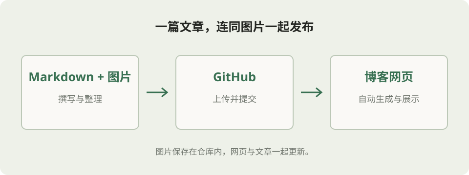

这份说明保存在博客仓库里，也会出现在网站顶部的「使用说明」中。日常更新只需要维护 Markdown 文章和配图，不需要在电脑上安装网站开发工具。

## 一、入口与目录

- [博客首页](https://frankcasbert.github.io/Blogs/)
- [GitHub 仓库](https://github.com/FrankCasbert/Blogs)
- [文章目录](https://github.com/FrankCasbert/Blogs/tree/main/_posts)
- [图片目录](https://github.com/FrankCasbert/Blogs/tree/main/assets/images)
- [构建检查](https://github.com/FrankCasbert/Blogs/actions)

```text
Blogs/
├── _posts/                         # Markdown 文章
│   ├── 2024-10-18-hello-world.md
│   └── 2026-10-25-blog-guide.md     # 本说明
├── assets/images/                  # 图片
│   └── blog-guide/
│       └── publishing.svg
├── _templates/post.md              # 可复制的文章模板
├── _layouts/                       # 网页模板，一般无需修改
├── styles/main.css                 # 网页样式
└── _config.yml                     # 博客名称等设置
```

## 二、发布一篇新文章

1. 打开仓库的 `_posts` 目录，选择 **Add file → Create new file**；已有文章也可以选择 **Upload files** 上传。
2. 文件名使用 `年-月-日-英文短标题.md`，例如 `2026-10-25-my-first-post.md`。正文和文章标题可以使用中文。
3. 在文件最上面填写下面的头部信息，再写 Markdown 正文。
4. 点击 **Commit changes**，将更改提交到 `main` 分支。
5. GitHub Pages 会自动生成网站，通常等待几分钟即可看到更新。以 Actions 中部署成功为准。

````markdown
---
title: "我的第一篇文章"
date: 2026-10-25 00:00:00 +0800
description: "这篇文章的一句话简介。"
categories: [技术笔记]
---

这里开始写正文。

## 小标题

支持 **加粗**、列表、链接、表格和代码块。

```python
print("Hello, Blog!")
```


````

其中 `title` 是网页标题，`description` 是首页摘要，`categories` 是分类。请把示例日期改成实际发布日期，时区保留 `+0800`。未来日期的文章在日期到达前不会展示；日期到达后仍需一次新的构建才会发布。

注意：头部的两行 `---` 必须保留，第一行前不要有正文；不要把整个文件放在代码块中。可以直接复制 `_templates/post.md`，修改后保存到 `_posts`。

新文章的访问地址会是 `/Blogs/posts/my-first-post.html`。普通文章请沿用默认地址规则，不要添加自定义 `permalink`，这样下面的图片相对路径才能同时用于 GitHub 预览和网页。

## 三、上传并引用图片

推荐每篇文章有一个对应的图片文件夹，例如：

```text
_posts/2026-10-25-my-first-post.md
assets/images/my-first-post/example.png
assets/images/my-first-post/screenshot.jpg
```

在文章中这样引用：

```markdown


```

路径中的 `../` 请保留。它让 GitHub 中 `_posts` 里的文章和网站中 `posts` 里的文章都能找到同一张图片，也适用于本博客的 `/Blogs` 子目录。

### 只通过 GitHub 网页上传

1. 在电脑上整理好 `assets/images/my-first-post/` 文件夹，把配图放入其中。
2. 打开仓库首页，选择 **Add file → Upload files**，拖入 `assets` 文件夹，保持目录结构，然后提交。上传前核对文件的仓库路径。
3. 再上传或编辑对应的 Markdown 文章，写入上面的相对路径并提交。
4. 最后打开博客文章确认图片已出现。图片会随正文宽度缩放，手机上也不会超出正文宽度。

如果使用 Git 或 GitHub Desktop，可以把文章和图片放入上述位置后一起提交、推送，避免中途短暂缺图。

### 真实图片示例

下面这张图片实际保存在仓库中，不依赖第三方图床：



对应的 Markdown：

```markdown

```

### 图片显示注意事项

- 图片本身也必须上传。仅上传 Markdown 文件不会自动带上电脑里的配图。
- 不要使用 `C:\...`、`file:///...` 或剪贴板临时路径；这些地址只在自己的电脑上有效。
- 使用 `/` 分隔路径，文件名大小写必须完全一致，`Photo.png` 与 `photo.png` 是不同文件。
- 文件夹和图片名建议使用英文、数字和短横线，避免空格和括号引起路径问题。
- 推荐 PNG、JPG、WebP、GIF 或 SVG；HEIC、TIFF 等格式建议先转换为 PNG/JPG。
- 大照片建议先缩小尺寸、压缩体积；截图保留清晰可读即可。
- 图片与文章一样公开，上传前确认图片中没有需要隐藏的内容。

外部 HTTPS 图片链接也可以使用，但原站失效、禁止外链或需要登录时就可能无法显示，所以优先将图片放在本仓库。

## 四、修改已有文章和网站信息

修改文章：打开 `_posts` 中对应文件，点击编辑，保存并提交即可。修改配图时保持原路径，或同步修改文章中的路径。文件名决定默认文章网址，已经分享出去的文章尽量不要改文件名。

修改网站名称或简介：编辑根目录 `_config.yml` 中的 `title`、`description` 和 `author`。当前部署在 `FrankCasbert/Blogs`，所以 `baseurl` 保持 `/Blogs`，`url` 保持 `https://frankcasbert.github.io`。

分类：修改文章头部的 `categories`，例如 `[技术笔记]`、`[生活随笔]`。首页、归档和分类页会自动更新，无需手动添加链接。

## 五、更新没有显示时如何排查

1. 确认文章在 `_posts` 中，文件名符合 `YYYY-MM-DD-slug.md`，头部信息完整。
2. 确认提交在 `main` 分支，日期不是未来时间，也没有设置 `published: false`。
3. 打开仓库 **Actions** 查看最近的检查和 Pages 部署。排队、执行中需要继续等待；红色失败则打开对应步骤查看原因。
4. 图片不显示时，先从 GitHub 打开图片本身，核对路径、大小写和扩展名；Markdown 中的路径应与本说明的规则一致。
5. 部署成功后仍看到旧页面，可以强制刷新浏览器，或使用无痕窗口核对。

## 六、首次启用或恢复 GitHub Pages

这一步只需设置一次，日常发文不需要重复操作：

1. 打开 [Settings → Pages](https://github.com/FrankCasbert/Blogs/settings/pages)。
2. 在 **Build and deployment** 中将 **Source** 设为 **Deploy from a branch**。
3. **Branch** 选择 `main`，目录选择 **/ (root)**，点击 **Save**。
4. 等待 GitHub 的 Pages 构建和部署完成，访问博客首页。

如果页面显示需要登录，请先使用你自己的 GitHub 账号登录。不要把源目录设成 `/docs`，不要添加 `.nojekyll`，因为本站需要 Jekyll 把 Markdown 生成网页。

## 七、可选的本地预览

日常通过 GitHub 网页发文不需要这一节。如果电脑已安装 Ruby、Bundler 与 Git，可以在仓库目录运行：

```bash
bundle install
bundle exec jekyll serve --baseurl /Blogs
```

然后打开 `http://127.0.0.1:4000/Blogs/`。本地预览只在自己的电脑运行；发布仍需将文件提交到 GitHub。

## 八、内容公开范围

本博客和仓库都是公开的，没有密码访问功能。尚未上传的重要内容请保留在本地；`_drafts`、未被首页列出的文件和后来删除的文件也不应当作保密存储。需要保密的内容不要提交进这个仓库。
